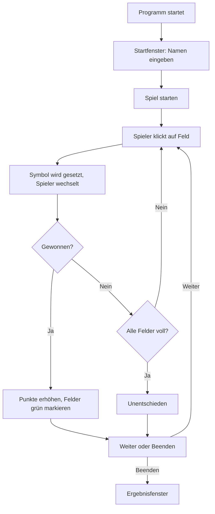

# Tic Tac Toe – Schritt-für-Schritt-Dokumentation

Diese Datei dokumentiert den kompletten Code von `tic tac toe.py`.
Erklärt wird alles von oben nach unten – so, wie Python den Code auch abarbeitet.

---

## 1. Überblick: Was macht das Programm?

Das ist ein **Tic Tac Toe** – aber nicht das klassische 3×3, sondern ein **4×4-Feld**.
Um zu gewinnen, braucht man 3 gleiche Symbole in einer Reihe
(waagerecht, senkrecht oder diagonal).

Zwei Spieler (X und O) klicken abwechselnd auf Felder.
Am Ende gibt es einen Punktestand und ein Ergebnisfenster.

**Ablauf:**
1. Startfenster → Namen der beiden Spieler eingeben
2. Hauptfenster → 4×4-Spielfeld, abwechselnd klicken
3. Gewinner oder Unentschieden wird erkannt
4. Punktestand wird erhöht
5. „Weiter" für neue Runde oder „Spiel beenden" für das Ergebnisfenster

---

## 2. Import und globale Variablen

```python
import tkinter as tk
```

- `tkinter` ist eine **Bibliothek** (Sammlung von fertigem Code), die in Python eingebaut ist.
- Damit erstellt man Fenster, Buttons, Labels usw. (grafische Oberflächen = GUI).
- `as tk` ist nur eine **Abkürzung**: Statt `tkinter.Button` schreibt man kürzer `tk.Button`.

```python
aktueller_spieler = "X"
punkte_x = 0
punkte_o = 0
name_x = ""
name_o = ""
```

**Variablen** sind wie kleine Kisten, in denen man Werte speichert:

| Variable | Bedeutung | Startwert |
|---|---|---|
| `aktueller_spieler` | Wer ist gerade dran? | `"X"` |
| `punkte_x` | Punktestand von X | `0` |
| `punkte_o` | Punktestand von O | `0` |
| `name_x` | Name von Spieler X | `""` (leer) |
| `name_o` | Name von Spieler O | `""` (leer) |

---

## 3. Das Hauptfenster

```python
fenster = tk.Tk()
```

Erstellt das **Hauptfenster** des Programms. `fenster` ist das Fenster-Objekt,
über das man alles steuert.

```python
fenster.title("Tic Tac Toe")
fenster.geometry("800x600")
fenster.configure(bg="black")
```

- `title(...)` → setzt den Fenstertitel (oben in der Fensterleiste).
- `geometry("800x600")` → Fenster ist 800 Pixel breit und 600 Pixel hoch.
- `configure(bg="black")` → Hintergrund wird schwarz (`bg` = background).

```python
fenster.withdraw()
```

**Wichtiger Trick:** `withdraw()` versteckt das Hauptfenster erst einmal.
Grund: Zuerst soll das Startfenster mit der Namenseingabe erscheinen.
Das Hauptfenster wird später mit `deiconify()` wieder eingeblendet.

---

## 4. Das Startfenster (Namenseingabe)

```python
startfenster = tk.Toplevel(fenster)
```

`Toplevel` ist ein **zusätzliches Fenster**, das über dem Hauptfenster schwebt.
So hat man zwei Fenster: eins für die Namen, eins für das Spiel.

```python
startfenster.title("Spieler wählen")
startfenster.geometry("320x280")
startfenster.configure(bg="black")
```

Gleiche Befehle wie beim Hauptfenster, nur für das Startfenster.

### Labels und Eingabefelder

```python
name_x_label = tk.Label(startfenster, text="Name Spieler 1 (X):", bg="black", fg="white", font=("Arial", 12))
name_x_label.pack(pady=(20, 0))
```

- `tk.Label(...)` → ein **Textfeld**, das nur Text anzeigt (nicht veränderbar).
- `text=...` → der angezeigte Text.
- `fg="white"` → Schriftfarbe (`fg` = foreground).
- `font=("Arial", 12)` → Schriftart Arial, Größe 12.
- `.pack(...)` → platziert das Element im Fenster. `pack` stapelt Elemente
  einfach untereinander.
- `pady=(20, 0)` → 20 Pixel Abstand **oben**, 0 Pixel unten.

```python
name_x_entry = tk.Entry(startfenster, font=("Arial", 12))
name_x_entry.pack(pady=5)
```

- `tk.Entry(...)` → ein **Eingabefeld**, in das der Spieler seinen Namen tippen kann.

Das Gleiche gibt es noch einmal für Spieler O: `name_o_label` und `name_o_entry`.

---

## 5. Die Funktion `spiel_starten()`

```python
def spiel_starten():
    global name_x, name_o
    name_x = name_x_entry.get()
    name_o = name_o_entry.get()
```

- `def` → definiert eine **Funktion**. Eine Funktion ist wie ein Rezept:
  Man schreibt sie einmal auf, ausgeführt wird sie nur, wenn sie aufgerufen wird.
- `global name_x, name_o` → sagt Python: „Ich will die **globalen** Variablen
  von oben ändern, nicht nur eine lokale Kopie." Ohne `global` würde Python
  die Änderung nach dem Funktionsende vergessen.
- `.get()` → holt den Text aus dem Eingabefeld.

```python
    if name_x == "":
        name_x = "Spieler 1"
    if name_o == "":
        name_o = "Spieler 2"
```

Lässt jemand das Feld leer, bekommt er automatisch „Spieler 1" bzw. „Spieler 2".

```python
    spieler_label.config(text=f"{name_x}: X\n{name_o}: O")
```

- `.config(text=...)` → ändert den Text eines Labels **nachträglich**.
- `\n` → Zeilenumbruch (newline), die Namen stehen also untereinander.
- `f"..."` → **f-String**: Damit baut man Variablen direkt in den Text ein
  (die Werte stehen in `{}`).

```python
    startfenster.destroy()
    fenster.deiconify()
    anzeige_aktualisieren()
```

- `destroy()` → schließt das Startfenster komplett.
- `deiconify()` → zeigt das versteckte Hauptfenster wieder an
  (Gegenteil von `withdraw`).
- `anzeige_aktualisieren()` → ruft die Funktion auf, die den Spielstand anzeigt.

### Der Start-Button

```python
start_button = tk.Button(startfenster, text="Spiel starten", ..., command=spiel_starten)
start_button.pack(pady=20)
```

- `tk.Button(...)` → ein **klickbarer Button**.
- `command=spiel_starten` → **sehr wichtig**: Hier wird festgelegt, welche
  Funktion beim Klick ausgeführt wird. **Ohne Klammern `()`**, weil man die
  Funktion nur „übergibt" und nicht sofort aufruft.

---

## 6. Spielfeld und Info-Bereich

```python
spielfeld_frame = tk.Frame(fenster, bg="black")
spielfeld_frame.pack(side="left", expand=True, fill="both")
```

- `tk.Frame(...)` → ein **Container** – eine unsichtbare Box, in die man andere
  Elemente packt. Damit gruppiert man Dinge.
- `side="left"` → der Container kommt auf die linke Seite.
- `expand=True, fill="both"` → er darf sich ausdehnen und den Platz ausfüllen.

```python
info_frame = tk.Frame(fenster, bg="black", width=200)
info_frame.pack(side="right", fill="y")
```

- Der Info-Container kommt rechts hin (`side="right"`), ist 200 Pixel breit
  und füllt die Höhe (`fill="y"`).

### Die Info-Labels

```python
dran_label = tk.Label(info_frame, text="", ...)   # zeigt, wer dran ist
spieler_label = tk.Label(info_frame, text="Spieler 1: X\nSpieler 2: O", ...)
punkte_label = tk.Label(info_frame, text="", ...)  # zeigt den Punktestand
```

Drei Labels, die später per `.config()` aktualisiert werden.

---

## 7. `anzeige_aktualisieren()`

```python
def anzeige_aktualisieren():
    dran_label.config(text=f"Am Zug:\n{aktueller_spieler}")
    punkte_label.config(text=f"Punkte:\nX: {punkte_x}   O: {punkte_o}")
```

Diese Funktion frischt die Anzeige auf: Wer ist dran, wie viele Punkte hat wer?

```python
    gewinner = gewinner_pruefen()
    if gewinner is not None:
        spiel_beenden(gewinner)
    elif alle_felder_voll():
        unentschieden()
```

- Es wird geprüft, ob jemand gewonnen hat (`gewinner_pruefen()` kommt später).
- `if gewinner is not None:` → wenn ein Gewinner **gefunden wurde**
  (`None` heißt „nichts").
- `elif` → sonst, wenn alle Felder voll sind → Unentschieden.

---

## 8. Die Klick-Funktionen (`klick1()` bis `klick16()`)

Alle 16 Funktionen sind praktisch identisch. Deshalb wird nur eine erklärt:

```python
def klick1():
    global aktueller_spieler
    button1.config(text=aktueller_spieler, state="disabled")
```

- `global aktueller_spieler` → wir ändern die globale Variable (wer dran ist).
- Der Button 1 bekommt das aktuelle Symbol (X oder O) als Text.
- `state="disabled"` → der Button wird **deaktiviert**, man kann nicht noch
  einmal darauf klicken.

```python
    if aktueller_spieler == "X":
        aktueller_spieler = "O"
    else:
        aktueller_spieler = "X"
    anzeige_aktualisieren()
```

Das ist der **Spielerwechsel**: War gerade X dran, ist jetzt O dran – und
umgekehrt. Danach wird die Anzeige aktualisiert.

> **Hinweis:** `klick2` macht dasselbe nur mit `button2`, `klick3` mit `button3`
> usw. Das ist viel Wiederholung – Profis würden das mit Schleifen kürzer
> machen, aber für den Anfang ist es gut lesbar.

---

## 9. Die Buttons und das Grid

```python
button1 = tk.Button(spielfeld_frame, text=" ", font=("Arial", 24), bg="black", fg="white", command=klick1)
button1.grid(row=0, column=0, sticky="nsew", padx=5, pady=5)
```

Jetzt kommt der große Unterschied zu vorher:

- Vorher wurde **`pack`** benutzt (einfach untereinander stapeln).
- Jetzt wird **`grid`** benutzt: Damit platziert man Elemente in einem
  **Raster** (wie eine Tabelle).
  - `row=0, column=0` → Zeile 0, Spalte 0 (ganz oben links).
  - `sticky="nsew"` → der Button „klebt" an allen Seiten fest und füllt die
    Zelle komplett aus (N = North, S = South, E = East, W = West).
  - `padx=5, pady=5` → 5 Pixel Abstand horizontal und vertikal.

So entsteht das 4×4-Spielfeld:

|          | Spalte 0 | Spalte 1 | Spalte 2 | Spalte 3 |
|----------|----------|----------|----------|----------|
| **Zeile 0** | button1  | button2  | button3  | button4  |
| **Zeile 1** | button5  | button6  | button7  | button8  |
| **Zeile 2** | button9  | button10 | button11 | button12 |
| **Zeile 3** | button13 | button14 | button15 | button16 |

```python
for i in range(4):
    spielfeld_frame.grid_rowconfigure(i, weight=1)
    spielfeld_frame.grid_columnconfigure(i, weight=1)
```

Das ist eine **Schleife**: `range(4)` zählt 0, 1, 2, 3. Der Code in der
Schleife wird also 4× ausgeführt.

- `grid_rowconfigure(i, weight=1)` → sagt der Zeile `i`: „Du darfst dich
  ausdehnen." `weight=1` heißt: Alle Zeilen teilen sich den Extra-Platz
  gleichmäßig. Ohne das würden die Buttons nicht mitwachsen, wenn das Fenster
  größer wird.

---

## 10. Die Button-Liste

```python
buttons = [
    [button1, button2, button3, button4],
    [button5, button6, button7, button8],
    [button9, button10, button11, button12],
    [button13, button14, button15, button16]
]
```

Das ist eine **Liste in einer Liste** (auch „2D-Liste" oder „verschachtelte
Liste" genannt). Damit kann man bequem auf jeden Button zugreifen:

- `buttons[0][0]` = button1 (Zeile 0, Spalte 0)
- `buttons[2][3]` = button12 (Zeile 2, Spalte 3)

Das ist viel praktischer als 16 einzelne Namen, wenn man das ganze Feld prüfen will.

---

## 11. `drei_gleich()` – die Gewinn-Hilfsfunktion

```python
def drei_gleich(b1, b2, b3):
    return b1["text"] == b2["text"] and b2["text"] == b3["text"] and b1["text"] != " "
```

Diese Funktion bekommt **3 Buttons** übergeben und prüft:

1. Haben alle drei denselben Text?
   (`b1["text"] == b2["text"]` und `b2["text"] == b3["text"]`)
2. Und ist dieser Text **nicht** leer?
   (`b1["text"] != " "` – sonst würden 3 leere Felder „gewinnen")

`return` → die Funktion gibt das Ergebnis zurück: `True` (= ja, 3 gleiche)
oder `False` (= nein).

`b1["text"]` ist übrigens eine andere Schreibweise für `b1.cget("text")` –
so liest man den aktuellen Text eines Buttons aus.

---

## 12. `gewinner_pruefen()` – wer hat gewonnen?

Das ist das Herzstück. Es prüft **alle möglichen Dreier-Linien** auf dem
4×4-Feld.

### Waagerecht

```python
for zeile in range(4):
    if drei_gleich(buttons[zeile][0], buttons[zeile][1], buttons[zeile][2]):
        return [buttons[zeile][0], buttons[zeile][1], buttons[zeile][2]]
    if drei_gleich(buttons[zeile][1], buttons[zeile][2], buttons[zeile][3]):
        return [buttons[zeile][1], buttons[zeile][2], buttons[zeile][3]]
```

In jeder Zeile gibt es auf einem 4er-Feld **2 mögliche Dreier-Reihen**:

- Spalten 0-1-2
- Spalten 1-2-3

Deshalb gibt es 2 `if`-Abfragen pro Zeile. Die Schleife wiederholt das für
alle 4 Zeilen.

### Senkrecht

Gleiches Prinzip, nur gedreht: Für jede Spalte werden die Zeilen 0-1-2 und
1-2-3 geprüft.

### Diagonalen

Hier gibt es **8 Möglichkeiten** (4 in jede Richtung), weil man mit 3 Feldern
auf einem 4×4-Feld diagonal „rutschen" kann.

**Von links oben nach rechts unten:**

```
X . . .        . . . .        . X . .        . . . .
. X . .        . X . .        . . X .        . . X .
. . X .        . . X .        . . . X        . . . X
. . . .        . . . X        . . . .        . . . .
```

**Von rechts oben nach links unten:** (spiegelverkehrt)

```python
return None
```

Wenn keine Linie gefunden wurde, gibt die Funktion `None` zurück
(also „kein Gewinner").

---

## 13. `spiel_beenden()` – wenn jemand gewonnen hat

```python
def spiel_beenden(gewinner_buttons):
    global punkte_x, punkte_o
    gewinner = gewinner_buttons[0]["text"]
```

Die Funktion bekommt die Liste der 3 Gewinner-Buttons. Aus dem ersten holt
sie das Symbol (`"X"` oder `"O"`).

```python
    if gewinner == "X":
        punkte_x = punkte_x + 1
    else:
        punkte_o = punkte_o + 1
```

Punktestand erhöhen – je nachdem, wer gewonnen hat.

```python
    dran_label.config(text=f"Gewinner: {gewinner}!")
    punkte_label.config(text=f"Punkte:\nX: {punkte_x}   O: {punkte_o}")
```

Anzeige aktualisieren: „Gewinner: X!" und der neue Punktestand.

```python
    for b in gewinner_buttons:
        b.config(bg="green")
```

Die 3 Gewinner-Felder werden **grün** markiert – so sieht man schön, welche
Reihe gewonnen hat.

```python
    for zeile in range(4):
        for spalte in range(4):
            buttons[zeile][spalte].config(state="disabled")
```

Das ist eine **verschachtelte Schleife** (Schleife in Schleife): Alle 16
Buttons werden deaktiviert, damit niemand mehr klicken kann.

---

## 14. `alle_felder_voll()` und `unentschieden()`

```python
def alle_felder_voll():
    for zeile in range(4):
        for spalte in range(4):
            if buttons[zeile][spalte]["text"] == " ":
                return False
    return True
```

Geht alle 16 Felder durch. Sobald **ein einziges** noch leer ist (`" "`),
gibt es `False` zurück (= nicht voll). Erst wenn alle belegt sind, `True`.

```python
def unentschieden():
    dran_label.config(text="Unentschieden!")
    for zeile in range(4):
        for spalte in range(4):
            buttons[zeile][spalte].config(state="disabled")
```

Zeigt „Unentschieden!" an und deaktiviert alle Buttons.

---

## 15. `neue_runde()` und `spielstand_zuruecksetzen()`

```python
def neue_runde():
    global aktueller_spieler
    aktueller_spieler = "X"
    for zeile in range(4):
        for spalte in range(4):
            buttons[zeile][spalte].config(text=" ", state="normal", bg="black")
    anzeige_aktualisieren()
```

- X fängt wieder an.
- Alle Buttons werden geleert (`text=" "`), wieder **aktiv**
  (`state="normal"`) und wieder **schwarz** (`bg="black"`).
- Anzeige aktualisieren.

```python
def spielstand_zuruecksetzen():
    global punkte_x, punkte_o
    punkte_x = 0
    punkte_o = 0
    neue_runde()
```

Setzt die Punkte auf 0 zurück und startet dann eine neue Runde
(eine Funktion ruft eine andere Funktion auf – das ist normal und heißt
„Funktionsaufruf in Funktion").

---

## 16. `programm_beenden()` und `wirklich_beenden()`

```python
def programm_beenden():
    fenster.withdraw()
    ergebnis_fenster = tk.Toplevel(fenster)
    ...
```

- Hauptfenster wird wieder versteckt (`withdraw`).
- Ein neues Fenster (`Toplevel`) wird erstellt – das **Ergebnisfenster**.

```python
    if punkte_x > punkte_o:
        ergebnis_text = f"{name_x} hat gewonnen!"
    elif punkte_o > punkte_x:
        ergebnis_text = f"{name_o} hat gewonnen!"
    else:
        ergebnis_text = "Unentschieden!"
```

Wer hat mehr Punkte? Drei Fälle:

- X hat mehr → `name_x` hat gewonnen.
- O hat mehr → `name_o` hat gewonnen.
- Gleichstand → Unentschieden.

> Hier sieht man auch, wofür die `name_x`/`name_o`-Variablen gut sind:
> Im Ergebnisfenster stehen die **echten Namen** statt nur X und O.

Dann werden ein großes Label mit dem Ergebnis, ein Label mit den Punkten und
ein „Beenden"-Button erstellt.

```python
def wirklich_beenden():
    fenster.destroy()
```

`destroy()` auf dem **Hauptfenster** schließt das komplette Programm
(auch alle Toplevel-Fenster, die davon abhängen).

---

## 17. Die Buttons in der Info-Leiste

```python
weiter_button = tk.Button(info_frame, text="Weiter", ..., command=neue_runde)
reset_button = tk.Button(info_frame, text="Spielstand zurücksetzen", ..., command=spielstand_zuruecksetzen)
ende_button = tk.Button(info_frame, text="Spiel beenden", ..., command=programm_beenden)
```

Drei Buttons rechts im Info-Bereich:

- **Weiter** → startet eine neue Runde.
- **Spielstand zurücksetzen** → Punkte auf 0.
- **Spiel beenden** → zeigt das Ergebnisfenster.

---

## 18. Die Hauptschleife

```python
fenster.mainloop()
```

**Das ist der Motor des Programms!**

`mainloop()` = „main loop" = Hauptschleife. Sie läuft **endlos**
(bis das Fenster geschlossen wird) und macht Folgendes:

1. Sie **wartet auf Ereignisse** (z. B. Mausklicks, Tastendrücke).
2. Wenn ein Ereignis kommt (z. B. Klick auf Button 1), ruft sie die passende
   Funktion auf (hier `klick1`).
3. Danach wartet sie wieder.

Ohne `mainloop()` würde das Fenster sofort wieder verschwinden und keine
Klicks verarbeiten. Denk an einen Kellner, der die ganze Zeit wartet und
reagiert, wenn ein Gast ruft.

---

## 19. Zusammenfassung als Ablaufplan



---

## 20. Wichtige Begriffe auf einen Blick

| Begriff | Bedeutung |
|---|---|
| `tk.Tk()` | Hauptfenster erstellen |
| `tk.Toplevel()` | Zusätzliches Fenster erstellen |
| `tk.Label()` | Text anzeigen |
| `tk.Entry()` | Eingabefeld |
| `tk.Button()` | Klickbarer Button |
| `tk.Frame()` | Unsichtbarer Container zum Gruppieren |
| `.pack()` | Elemente untereinander stapeln |
| `.grid()` | Elemente in einem Raster platzieren |
| `.config(...)` | Eigenschaften nachträglich ändern |
| `.get()` | Text aus einem Eingabefeld holen |
| `.destroy()` | Fenster schließen |
| `withdraw()` / `deiconify()` | Fenster verstecken / wieder zeigen |
| `def` | Funktion definieren |
| `global` | Globale Variable in einer Funktion ändern |
| `return` | Wert aus einer Funktion zurückgeben |
| `for ... in range(...)` | Schleife (Code mehrfach ausführen) |
| `if / elif / else` | Bedingungen prüfen |
| `f"..."` | f-String (Variablen in Text einbauen) |
| `\n` | Zeilenumbruch |
